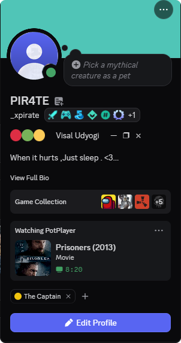

# Media RPC: Discord Rich Presence for PotPlayer, VLC, MPC-HC and more

**Show what you're watching on Discord.** Media RPC is a free Discord Rich Presence app for Windows. It detects the film or TV episode playing in your video player (PotPlayer, VLC, KMPlayer, MPC-HC, MPC-BE, SMPlayer, mpv, GOM Player) and displays it on your Discord profile as a **"Watching ..."** card, complete with poster, season and episode, and episode title.

Windows only. No Python, no API keys, no setup: download the exe and run it.

<p align="center">
  
</p>
<p align="center">
  
</p>
<p align="center"><sub>Example: a film playing in PotPlayer, shown on a Discord profile.</sub></p>

## Features

- **Automatic detection.** Reads the player's window title and works out whether it's a film or a series episode.
- **Posters and episode names.** Fetched automatically from TVmaze, iTunes, IMDb and Wikipedia.
- **Smart filename cleanup.** Strips release noise such as `1080p`, `x265`, `BluRay`, `English`, `Sinhala Sub` and site tags like `[CineSubz.com]`.
- **Safe matching.** A poster is only used when the title (and year) really match your file, so you never get the wrong film's artwork.
- **System tray.** Closing the window keeps the app running quietly in the tray.
- **Desktop shortcut.** The first time you open the exe, it adds a "Media RPC" shortcut to your desktop.
- **Start with Windows.** Optional auto-start, minimized to the tray.
- **One instance only.** Opening it twice just tells you it's already running.
- **Online updates.** Shows a tray notification when a new version is out and updates itself in one click.
- **Pause detection.** Shows "Paused" on your Discord card while the video is paused, and the timer continues from where it stopped when you resume.

## Supported players

PotPlayer, VLC, KMPlayer, MPC-HC, MPC-BE, SMPlayer, mpv and GOM Player.

> Windows Media Player and the Windows 11 "Media Player" app don't put the film name in their window title, so they can't be detected.

## Quick start

1. Download the latest `MediaRPC.exe` from the **Releases** page.
2. Put it somewhere permanent (for example `C:\Apps\MediaRPC\`) and double-click it. *"Start with Windows" uses the location of the exe, so don't move it afterwards without toggling the option off and on.*
3. Keep the **Discord desktop app** open.
4. Play a film or episode in your player. It now shows on your Discord profile.

You only need Windows and the Discord desktop app. The Discord Application ID is built in, so there's nothing to create or configure, and you can copy the exe to other PCs.

> **Windows SmartScreen** may warn about an "unrecognized app" because the exe isn't code-signed. Click **More info > Run anyway**.

### The app window

- **Status**: Connected, or "Discord not found, retrying...".
- **Now watching**: the player, the detected title, whether a poster was found, and elapsed time.
- **Start / Stop**: switch the presence off and on.

### System tray

- Closing the window with **X** minimizes Media RPC to the system tray (the `^` arrow next to the clock).
- **Double-click** the tray icon to reopen the window. **Right-click** for: Show window, Start/Stop, Start with Windows, **Quit**.
- Use **Quit** from the tray menu to fully close the app.
- **Start with Windows** turns on by default the first time you run the app. You can switch it off in the window or the tray menu.

## Updates

Media RPC checks GitHub Releases shortly after it starts and then every 6 hours. When a newer version exists, the window shows **Update available** with an **Update and restart** button. Nothing is installed until you click it.

What happens when you click:

1. The new `MediaRPC.exe` and its `MediaRPC.exe.sha256` checksum are downloaded from this repository's Releases page.
2. The download is only installed if the SHA-256 checksum matches, the size looks right and it is a real Windows exe. Otherwise it is discarded.
3. The running exe is swapped for the new one and Media RPC restarts itself (minimized to the tray if it was hidden). Your settings and "Start with Windows" are kept.

Good to know:

- The check is a single request to the GitHub API. It sends no personal data (GitHub sees your IP address and the app version, like any download). Only HTTPS connections to GitHub are allowed.
- Turn automatic checks off with **Check for updates automatically** in the window. You can still use **Check for updates** in the tray menu.
- If the exe sits in a folder that needs administrator rights (like `C:\Program Files`), or you run from source, the button opens the download page instead.
- The first release that contains the updater must be installed manually. After that, updates are one click.

## How detection works

| Step | What happens |
| --- | --- |
| 1. Find the player | Looks for a supported player window and reads its title. |
| 2. Parse the name | Handles `S01E01`, `1x01`, `Show - 05`, `Title (2025)`, `Title.2010.1080p...` and similar. Quality, language and site tags are removed. |
| 3. Look up artwork | **Series:** TVmaze, then IMDb. **Films:** iTunes, then IMDb, then Wikipedia. Episode names come from TVmaze. |
| 4. Show the card | Sent to Discord as a "Watching" activity with the poster as the large image. |

Good to know:

- Lookups use only the cleaned-up title (and year); nothing else about your system or files is sent.
- If no confident match is found, or you're offline, the card shows just the title. Media RPC retries about every 30 seconds.
- If a title is detected wrongly, check `parse_filename` in `media_info.py`.
- Elapsed time starts when the title is detected. Players don't expose playback position through the window title, so there's no progress bar.

## The "Get Media RPC" button

The card includes a **Get Media RPC** button linking to this repository. Change the label or link with `PROJECT_BUTTON` and `PROJECT_URL` in `media_rpc.py`.

> Discord only shows Rich Presence buttons to **other people**, never on your own profile. To check it works, ask a friend to open your profile (on the desktop app) while you're watching, or use a second account.

## Customization

### Add a player

Add a line to the `PLAYERS` list in `players.py`: a display name, the start of the process's exe name (lowercase), and a regex for the player name as it appears in the window title.

```python
Player("MyPlayer", ("myplayer",), r"MyPlayer"),
```

### Change the name shown on the card

The text after "Watching" is the name of the **Discord Application**. Open the [Discord Developer Portal](https://discord.com/developers/applications), pick your application, then go to **General Information > Name** and rename it (for example "Media Player"). The Application ID stays the same.

### Show an image when there is no poster

When no poster is found Discord shows a "?" placeholder. To replace it, upload an image named `default_poster` under **Rich Presence > Art Assets** in the Developer Portal. It is used automatically.

## Run from source

Requires Windows and Python 3.

```
pip install -r requirements.txt
python media_rpc.py
```

To use your own Discord Application, change `CLIENT_ID` in `media_rpc.py`.

## Build the exe

Pushing a tag that starts with `v` (for example `v1.6.2`), or publishing a release in **Releases > Draft a new release**, triggers GitHub Actions to build `MediaRPC.exe` and attach it, together with `MediaRPC.exe.sha256`, to the release. The tag becomes the app's version number, and installed copies of Media RPC will offer it as an update once the exe is attached. Use a higher version than the previous release (`v1.6.2` after `v1.6.1`).

Without a tag, run **Actions > Build Windows exe > Run workflow** and download the result from **Artifacts**.

## Project layout

| File | Purpose |
| --- | --- |
| `media_rpc.py` | App window, tray and the Discord Rich Presence worker |
| `media_info.py` | Filename parsing and poster / episode lookup |
| `players.py` | Supported players and window-title detection |
| `system_integration.py` | Start with Windows and single-instance handling |
| `updater.py` | Online updates: version check, verified download, exe swap |
| `app_version.py` | App version (set from the release tag when building) |
| `app_icon.py` | Generates the app icon |

## Troubleshooting

- **Nothing shows on Discord:** open Discord **Settings > Activity Privacy** and make sure **Share your detected activity** is on.
- **"Discord not found, retrying...":** make sure the Discord **desktop app** is running (not just the browser). Discord and Media RPC should run with the same permission level (both normal, not one as administrator). It reconnects automatically after a Discord restart.
- **Player not detected:** the window title must look like `film name - Player name`, or be just the file name with its extension. Check that your player is in the list in `players.py`.
- **Wrong or missing poster:** see "How detection works" above. A title with an unusual name may need a fix in `media_info.py`.

## Limitations

- Windows only.
- Pausing a film doesn't change the status, because the window title doesn't reveal pause state.
- No progress bar (see above).
